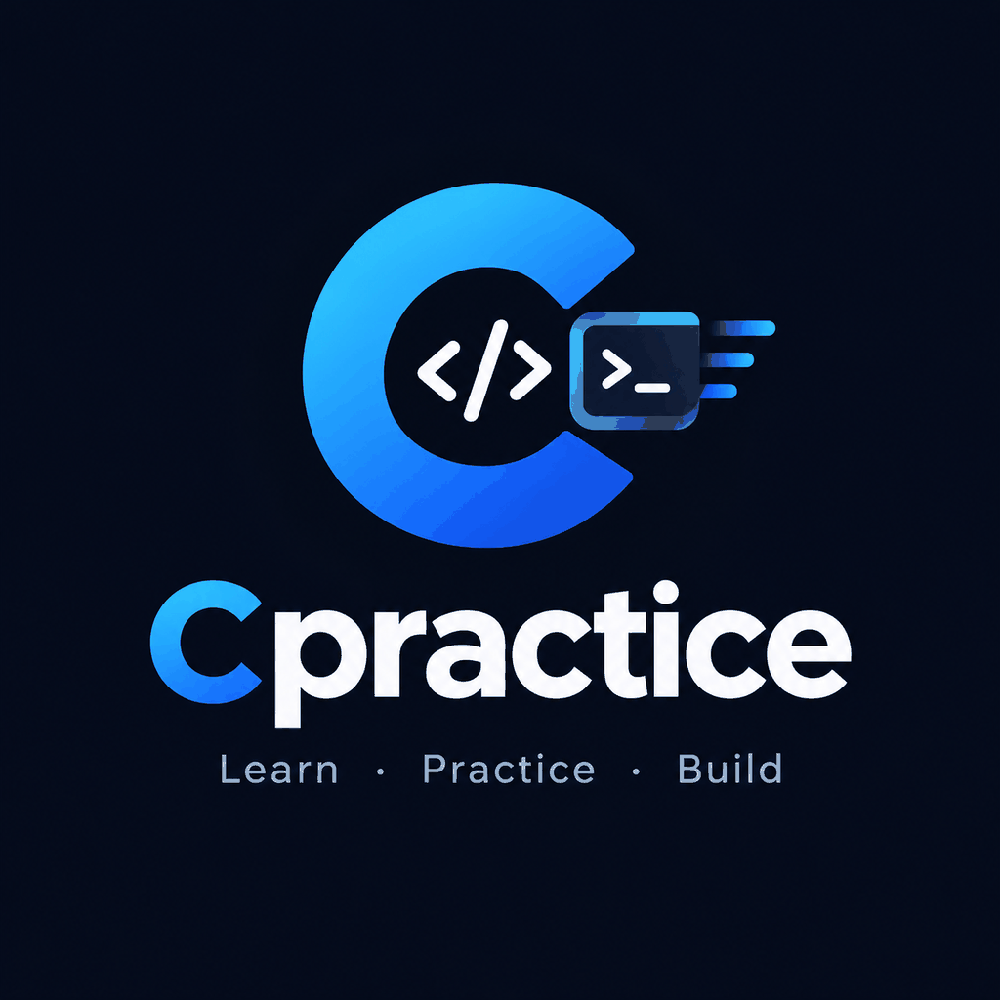
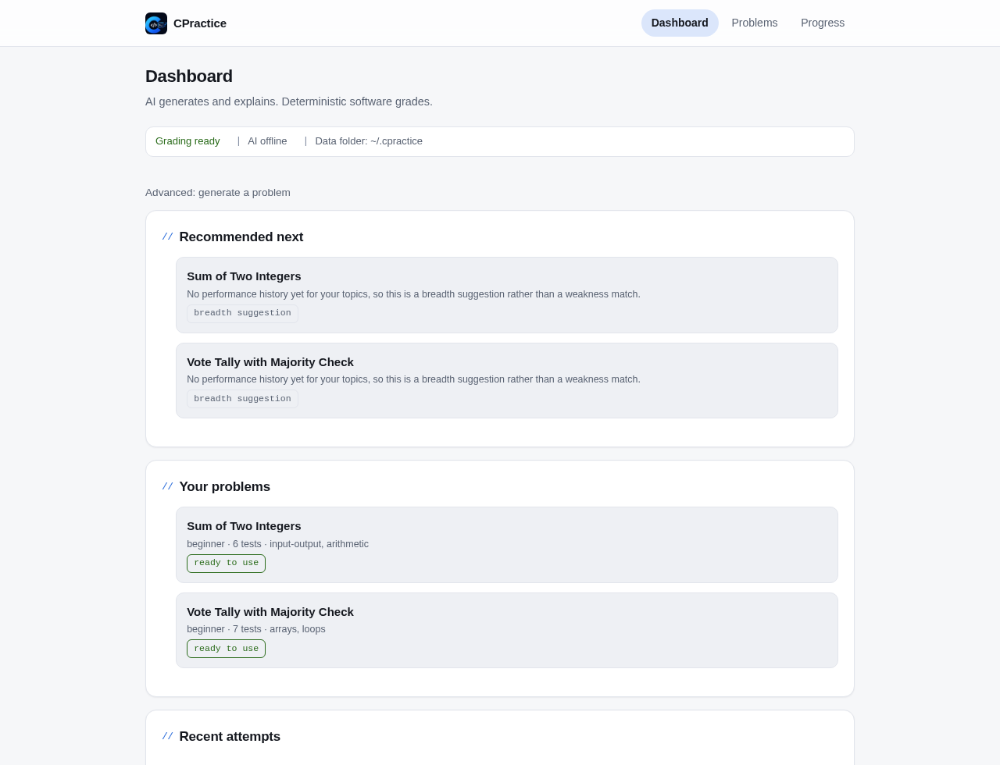
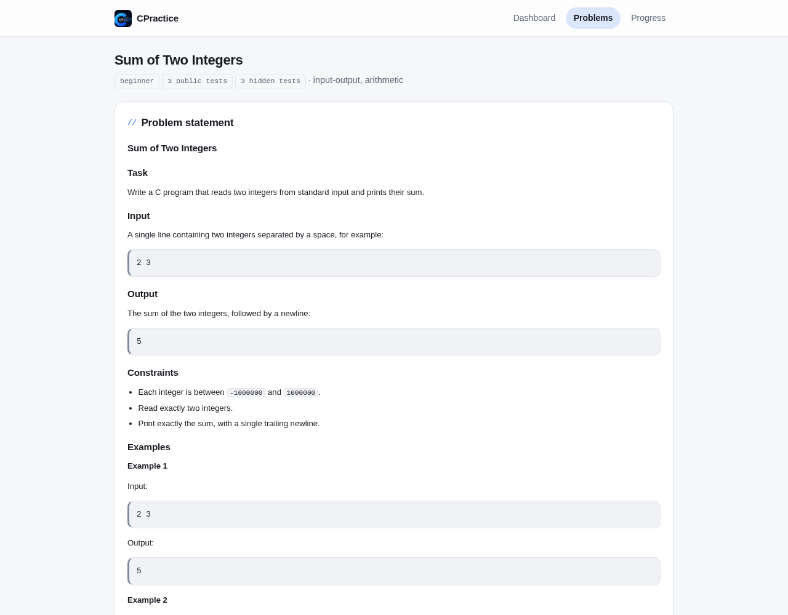

# CPractice

<p align="center">
  
</p>

**Practise C on your own machine, with real compiler feedback and deterministic grading in your browser.**


CPractice is a local-first practice app for C. It serves a small problem shelf,
compiles and runs what you write against declared tests, and gives the same
verdict every time. AI can generate exercises and help when you are stuck, but
it never decides whether your program is correct.

## What it is

- A problem shelf that ships with two beginner exercises and can hold your own
  imported or generated packages.
- A browser workspace where you read the statement, write C, and submit source
  without leaving the page.
- Per-test results from a real compiler and runner, not from a language model.
- Progressive hints, attempt history, and evidence-based next-practice
  suggestions.
- Your practice history stays on this machine: no account, no cloud sync, no
  telemetry.

The browser is the interface: plain HTML, CSS, and JavaScript, no build step and
no frontend framework, served from your own machine.

## A look at it

<p align="center">
  
  
</p>

## Install

CPractice runs on Linux, macOS, WSL2, and Termux on Android. It needs Python
3.12 or newer, a C compiler, and `pipx` or `uv` to install the command. The
first install downloads from GitHub, so it needs network access.

```bash
pipx install "cpractice @ git+https://github.com/DeltaRhoSygnis/cpractice.git"
cpractice start
```

`uv` users can replace the first command with
`uv tool install "cpractice @ git+https://github.com/DeltaRhoSygnis/cpractice.git"`.
If the compiler is missing, `cpractice doctor` prints the exact install command
for your platform.

From a clone of this repository, `scripts/install.sh` is a guided checker: it
detects `uv`/`pipx` and a C compiler, prints the next command, and only installs
when you pass `--yes`. It never pipes remote code into a shell.

## Your first problem

1. Run `cpractice start`. It starts the local app and opens it in your browser
   at `http://127.0.0.1:8000`.
2. Open **Problems** and choose an exercise, for example *Sum of Two Integers*.
3. Read the statement and write your C solution in the workspace editor. Your
   draft is saved in this browser; nothing is submitted until you submit it.
4. Press **Submit**. You get a verdict and a pass/fail line for each test; hidden
   tests contribute to the verdict without revealing their input or output.
5. Stuck? Ask for a hint. Levels unlock one at a time, and stored hints work
   even with no AI provider configured.

That is the whole loop: start, pick, write, submit, hint. The first pass takes
about a minute, and `Ctrl+C` stops the server cleanly.

## Who it is for

- **Learners** working through C for the first time, alone and at their own pace.
- **Self-taught developers** who want compiler-accurate practice, not quizzes.
- **Individual teachers** preparing exercises for their own use.

CPractice is not a classroom product. There are no accounts, rosters, class
dashboards, or multi-user permissions; one person practises on one machine.

## Why the grading can be trusted

- Your source is compiled with the configured C compiler and run against
  declarative tests in a dedicated temporary workspace.
- Time, memory, and output limits come from configuration, not from the AI.
- Comparison is mechanical: exact normalized or whitespace tolerant, per the
  problem's declared contract.
- Hidden inputs and expected outputs are never sent to the browser. For hidden
  tests, the client receives only the test name and its verdict, not the input
  or expected output.
- AI never decides pass/fail. A model can be wrong, offline, or unavailable
  without changing a single verdict.
- The same evaluator grades your submission and screens the exercise's
  reference solution, so the thing that judges you also validated the problem.

## Managing your practice

**The three pages.** **Dashboard** shows recent work, the shelf, a status strip,
and a collapsed **Advanced** section for generating a problem. **Problems** is the
shelf you browse and open. **Progress** shows attempts, trends, and next-practice
recommendations.

**`cpractice doctor`.** Run it whenever something looks wrong. It checks the
Python version, writes to the data folder, performs a real compile-and-run of a
tiny C program, checks whether the port is free, and reports AI status as
information only. Every failure prints one fix for your platform; the command
exits non-zero when practice cannot work.

**Your data folder.** `cpractice version` prints the exact home directory. An
installed copy uses `~/.cpractice/`; a source checkout keeps its files in the
repository root. The folder holds `problems/` (your shelf), `workspaces/`
(transient grading files), `data/cpractice.db` (attempt history), `state.json`
(the last address `cpractice start` used), and `env.example`. The template is
fully commented out; copy it to `.env` in the same folder if you add AI
settings. Existing problems are never overwritten by a CPractice upgrade.

Other commands: `cpractice problems` lists the shelf, `cpractice open` reopens a
running instance, and `cpractice version` shows the version and data folder.

## AI is optional

Offline practice is a first-class path. With no AI provider configured:

- both seeded problems load, compile, run, and grade normally;
- stored hints still unlock level by level;
- attempt history and progress pages still work.

An AI provider is needed only to generate new exercises and to draft hints that
were not authored with the problem. Add one when you want those features; the
`env.example` template lists the supported providers, and placeholder values
shipped as examples are treated as unset, so copying the template cannot make
the app claim AI is available when it is not.

## Advanced

Power features live in [`docs/ADVANCED.md`](docs/ADVANCED.md): importing
packages, generation and batch preparation, provider configuration, the full
HTTP interface, the complete environment-variable reference, LAN sharing,
packaging notes, and client integration for external agents.

## Development

See [`CONTRIBUTING.md`](CONTRIBUTING.md) for the test and layout rules, and
[`docs/PLAN.md`](docs/PLAN.md) for the architecture and milestones. The stack is
Python 3.12, FastAPI, and plain HTML/CSS/JS; the test suite is hermetic and uses
mocked AI responses. Run it with `pytest`. The security model, including why
public hosting remains blocked, is documented in [`SECURITY.md`](SECURITY.md).
