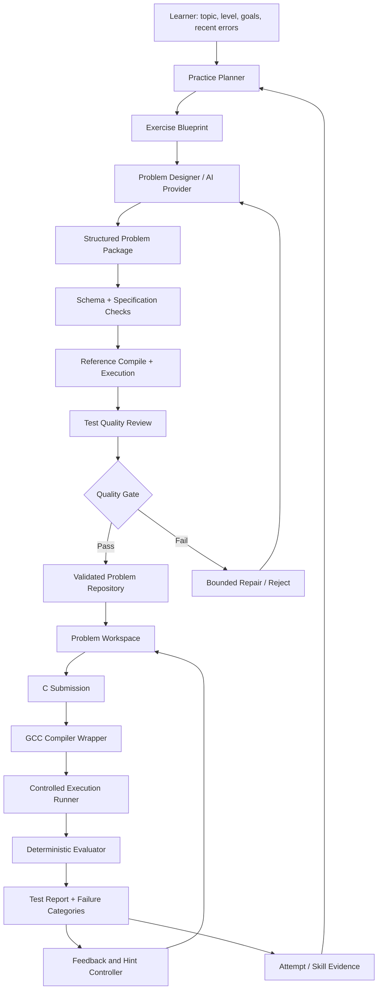

# CPractice — CS50-Style Problem Design and Learning Engine

**Document type:** Product and engineering specification  
**Project:** CPractice  
**Primary use:** Personal C programming practice  
**Initial environment:** Local browser application + local Python backend + GCC + AI API  
**Future environment:** Hosted website using the same problem format and grading engine  
**Design target:** Original problems with the rigor, precision, progression, and independent problem-solving emphasis associated with a demanding introductory computer science course such as CS50x.

> **Scope clarification:** The goal is not to copy Harvard or CS50 assignments, wording, test cases, or solutions, and it is not possible to guarantee equivalent teaching quality merely by using a prompt. The goal is to build an original problem-set system informed by the same broad educational principles: clear specifications, conceptual progression, deliberate practice, algorithmic reasoning, meaningful edge cases, automated feedback, and independent problem-solving.

---

## 1. Executive objective

CPractice currently generates basic exercises and grades C submissions. The next objective is to turn it into a **personal, AI-assisted computer science practice environment** where a learner can repeatedly attempt challenging, carefully designed problems without having to hold a separate AI conversation for every problem.

The current weak point is not primarily the user interface or compiler. It is the **pedagogical quality of generated problems**. A problem such as “Sum of First N Positive Integers” can be a useful warm-up, but a steady stream of similar exercises will not teach a learner how to decompose unfamiliar problems, derive loop bounds, select algorithms, reason about arrays, or debug incorrect assumptions.

The system must therefore design a sequence of learning experiences—not merely generate isolated coding prompts.

### The learning outcome

A learner should gradually become better at:

1. Translating prose into precise input, output, and behavioral requirements.
2. Identifying the unknowns and decomposing a problem into smaller tasks.
3. Choosing an algorithm before writing C syntax.
4. Deriving loop initialization, conditions, updates, and boundaries.
5. Tracing variables and state changes accurately.
6. Working with conditions, loops, arrays, strings, functions, pointers, memory, and data structures as they are introduced.
7. Designing and using test cases independently.
8. Interpreting compiler diagnostics and runtime behavior.
9. Recognizing recurring patterns while still adapting them to new problems.
10. Solving novel problems without having the answer or algorithm given immediately.

### Core product principle

**The AI designs and explains exercises. A deterministic test engine grades the code. A pedagogical layer controls sequencing, scaffolding, and review.**

Do not make an AI response the authority for correctness. Do not confuse a model's ability to generate plausible instructions with the ability to create a sound educational exercise.

---

## 2. What “CS50-style rigor” means for this product

Use the following characteristics as design targets. They are requirements for CPractice, not claims that the platform automatically achieves Harvard-level teaching.

### 2.1 Precise problem specifications

Every exercise must state:

- The task and desired behavior.
- Input format and valid input domain.
- Output format.
- Constraints and assumptions.
- Examples and their expected outputs.
- What counts as valid behavior for edge cases.
- Any restrictions on libraries or language features.
- How the submission will be evaluated.

Avoid ambiguous phrases such as “handle input appropriately” or “print the correct pattern.” Specify the actual behavior.

### 2.2 Problem-solving before code

The learner should be encouraged to reason about the problem before opening the editor. For selected problems, the interface should provide a short optional planning worksheet:

- What is given?
- What must be produced?
- What changes during the algorithm?
- What must remain true after each iteration?
- What are the smallest and largest relevant cases?
- How can the result be checked manually?

The tool should not force a long worksheet for every small exercise. Use it when it helps the objective, especially for algorithmic reasoning and loop-boundary problems.

### 2.3 Meaningful progression

Problems must increase difficulty by changing the reasoning demands, not just by using larger numbers or longer code.

Progression may add one or more of the following:

- More complex input conditions.
- Multiple interacting requirements.
- A need to choose an algorithm.
- State that must be maintained across iterations.
- Array or string traversal.
- Boundary cases that challenge naive solutions.
- Constraints that make an inefficient approach unsuitable.
- Decomposition into functions.
- Memory ownership and pointer reasoning when those concepts have been taught.

Do not combine many unfamiliar concepts in the first exercise for a topic.

### 2.4 Feedback that does not destroy the learning task

Show test results and factual diagnostics first. Reveal increasingly explicit hints only when requested. The default feedback should not reveal hidden expected outputs, full pseudocode, or the reference solution.

### 2.5 Independent, original exercises

Create new scenarios, specifications, examples, and tests. Do not reproduce CS50's specific assignment statements or solutions. General concepts such as arrays, algorithms, loops, and memory are not proprietary, but published problem text and specific assignment expression should not be copied.

---

## 3. Target architecture

Add a dedicated problem-design and pedagogy subsystem to the existing CPractice application. Do not rewrite the existing UI or grading engine unless testing reveals a genuine architectural defect.



### Responsibilities

**Practice Planner:** Selects a suitable type of exercise based on user-selected goals, prerequisite skills, and evidence from previous attempts. The first iteration can use explicit user selections; adaptive recommendations can come later.

**Exercise Blueprint:** Defines what the problem is intended to teach before the full problem is written. It contains the learning objective, prerequisite skills, target reasoning moves, likely misconceptions, difficulty profile, and acceptance checks.

**Problem Designer:** Produces the student-facing statement, examples, starter code if needed, tests, reference solution, hints, and rubric from the blueprint.

**Quality Gate:** Rejects malformed, contradictory, untestable, trivial, or poorly aligned exercises before they appear in the problem list.

**Problem Repository:** Stores complete, versioned problem packages so exercises can be reused without another AI request.

**Grading Engine:** Compiles and executes submissions against validated tests. It does not ask an AI model to decide whether output is correct.

**Feedback and Hint Controller:** Reveals hints progressively and explains observable failure categories without overstating the cause of a bug.

**Attempt / Skill Evidence:** Stores what happened in a submission. It should track observed evidence, not claim to know the learner's ability from one score.

---

## 4. Exercise design: required structure

Every generated exercise must be designed in two stages: first an internal blueprint, then the student-facing exercise package.

### 4.1 Exercise blueprint

Required fields:

- `primary_objective`: one main skill the exercise is intended to develop.
- `secondary_objectives`: optional supporting skills.
- `prerequisites`: concepts assumed to be known.
- `target_reasoning_moves`: observable reasoning actions the learner must perform.
- `likely_misconceptions`: common incorrect approaches the test suite should expose.
- `difficulty_profile`: why the problem has the selected difficulty.
- `solution_independence`: how much scaffolding may be shown by default.
- `transfer_goal`: what related but different problem the learner should be better able to solve afterward.
- `acceptance_criteria`: conditions required for publication.

A label such as “loops” is insufficient. A better objective is: “Derive a loop's initial value, condition, and update so that every required item is processed exactly once, with no out-of-range access.”

### 4.2 Student-facing problem statement

Every statement must include:

1. Title.
2. Short context, only if it clarifies the task.
3. Exact task statement.
4. Input format.
5. Output format.
6. Constraints and valid input assumptions.
7. One or more examples with accurate input/output pairs.
8. Language or library restrictions where relevant.
9. Any required function signature or file/entry-point requirement.

Don't add story text merely to make a simple exercise appear sophisticated. The underlying reasoning should justify the difficulty.

### 4.3 Author-only material

Keep the following available to the grader and hint service but hidden from the normal student view:

- Reference implementation.
- Hidden tests and their expected outputs.
- Intended algorithm summary.
- Test-to-requirement mapping.
- Misconception catalog.
- Full solution explanation.
- Validation findings.

For a local personal application, these materials are not cryptographically secret because the user controls the files. The UI should still separate them to preserve the intended workflow. A hosted version must keep hidden tests server-side.

---

## 5. Curriculum and skill model

The engine needs a curriculum map. Do not generate disconnected problems from arbitrary topic strings alone.

### 5.1 Initial C learning map

The following is a proposed map. The learner can practice across topics, but exercises should not depend on material that has not been introduced unless the problem clearly labels it as a challenge.

| Stage | Concepts | Core reasoning practice |
|---|---|---|
| 0. Reading code | Expressions, types, input/output | Predict output and trace state |
| 1. Conditions | `if`, `else`, boolean expressions | Partition cases, find missing cases |
| 2. Loops | `for`, `while`, loop state | Count iterations, establish termination, derive bounds |
| 3. Accumulation and counting | Sum, product, count, min/max, predicates | Maintain a correct running state |
| 4. Nested loops and patterns | Row/column relationships, repeated work | Derive output dimensions and boundaries |
| 5. Functions | Parameters, return values, decomposition | Separate responsibilities and define contracts |
| 6. Arrays | Traversal, indexing, mutation | Bounds, invariants, multi-pass reasoning |
| 7. Strings | Character arrays, termination, parsing basics | Scan, count, classify, validate |
| 8. Algorithms | Linear search, sorting concepts, search trade-offs | Select and justify an approach |
| 9. Memory and pointers | Addresses, pointer operations, allocation as taught | Trace memory and reason about ownership and validity |
| 10. Data structures | Structs, linked structures, stacks/queues as taught | Model data, manage state, analyze operations |
| 11. Integration | Mixed concepts from prior stages | Decompose a novel problem independently |

The system must be configurable to the learner's course sequence. Do not claim that this table exactly reproduces any one university's syllabus.

### 5.2 Skill tags need operational definitions

Each tag should explain what observable performance demonstrates it. Example:

**`loop_bounds`**

- Can determine the first and final iteration.
- Can explain whether the upper bound is inclusive or exclusive.
- Can count expected iterations.
- Can detect one-extra or one-missing iteration.
- Can justify a loop condition using the problem's required domain.

**`algorithm_decomposition`**

- Identifies inputs, intermediate state, and output.
- Breaks a task into logically separate steps.
- Chooses an order for those steps.
- States how the algorithm makes progress toward completion.

**`array_traversal`**

- Uses valid indexes.
- Chooses correct start/end conditions.
- Processes each required element exactly as specified.
- Handles empty or minimum-size input if the specification permits it.

Avoid assigning mastery based only on a topic name or one passing score.

---

## 6. Problem-set structure and difficulty

Use a small set of exercise types to make each problem set teach deliberately. These are roles in the learning sequence, not necessarily separate UI pages.

### Type A — Diagnostic warm-up

Purpose: establish whether prerequisites are understood. Usually one main concept and low reading overhead. It should not dominate the practice session.

### Type B — Core reasoning problem

Purpose: make the learner derive the approach rather than directly reproduce a demonstrated pattern. Include realistic boundary conditions and require a complete implementation.

### Type C — Transfer problem

Purpose: use a familiar concept in a materially different context. The algorithmic reasoning is related, but the problem should not be a superficial renaming of the warm-up.

### Type D — Challenge problem

Purpose: combine concepts that have already been practiced or introduce a demanding variation with appropriate scaffolding available on request. It should not depend on several untaught concepts.

### Type E — Debugging / counterexample problem

Purpose: inspect an incorrect algorithm, find a counterexample, trace its behavior, or repair a limited defect. This complements implementation practice rather than replacing it.

### Type F — Reflection / transfer check

Purpose: ask the learner to explain why a solution works, identify an invariant, produce an edge case, or predict the behavior of a small variation. Keep this concise and optional for normal workflow.

### Suggested sequence for one skill unit

A typical unit may include a diagnostic, two core problems with different reasoning demands, one transfer problem, and an optional challenge. This is a starting pattern, not a rigid rule. The generator should choose sequence length based on the objective and available evidence, rather than padding every topic with the same number of exercises.

### Difficulty labels

Use `beginner`, `intermediate`, `advanced`, and `challenge` as broad labels, but also record separate dimensions:

- Concept novelty.
- Number of reasoning steps.
- Need for algorithm selection.
- State-management difficulty.
- Edge-case burden.
- Code decomposition requirements.
- Reading/specification complexity.
- Prerequisite depth.

A beginner problem can still require thought. An advanced problem should not merely use larger input values.

---

## 7. The generation pipeline

The generation process should be a staged pipeline with bounded retries. Do not send one enormous prompt and accept whatever comes back.

### Stage 1 — Build the blueprint

Create a blueprint from the user request and available curriculum metadata. Check that the objective is specific and prerequisites are appropriate.

### Stage 2 — Generate the specification

Generate the task description, input/output contract, constraints, examples, and restrictions before writing the solution. Ensure requirements are unambiguous and observable.

### Stage 3 — Generate a solution outline

Create an author-only algorithm outline and identify the main reasoning decisions. This is used for validation and hints; it must not be displayed automatically to the learner.

### Stage 4 — Design tests from requirements

Map each test to a requirement, boundary, or likely misconception. Include enough variety to distinguish common incorrect approaches. Keep public examples simple enough to illustrate the contract without disclosing the entire hidden suite.

### Stage 5 — Generate the reference implementation

Produce C code that follows the configured standard and allowed library constraints. It must compile and satisfy the full candidate test suite.

### Stage 6 — Validate statically

Validate schema, completeness, input assumptions, IDs, resource limits, restrictions, examples, and consistency between the statement and package metadata.

### Stage 7 — Execute validation

Compile the reference implementation. Execute it against every test. Reject any mismatch, timeout, or abnormal exit. Where practical, independently calculate expected results or compare with a second, structurally different oracle.

### Stage 8 — Review pedagogical quality

Ask a separate review step to assess whether the exercise truly tests the stated objective, relies only on taught prerequisites, has useful edge cases, and is not a near-duplicate of recent exercises. A second model review is useful evidence, not proof.

### Stage 9 — Mutation testing

Where practical, test deliberate faulty variants such as off-by-one conditions, skipped elements, incorrect initialization, wrong comparison operators, or ignored edge cases. If obvious incorrect implementations still pass, improve the tests or reject the package.

### Stage 10 — Publish or reject

Save only exercises that meet hard validation requirements. A limited repair attempt may fix a package, but it must rerun the entire validation pipeline. Do not silently lower the quality gate after repeated failures.

### Required generation outcome

Every request must end in one of these states:

- `validated`: passed required checks and can be assigned.
- `needs_review`: structurally sound but a noncritical quality concern remains; personal-use policy can decide whether to show it with a warning.
- `rejected`: failed a hard requirement; do not present as a ready exercise.
- `generation_failed`: provider or pipeline error; explain the failure and retain existing exercises.

---

## 8. Test quality requirements

A problem's test suite is a major part of its instructional value.

### Required test categories when applicable

- Public examples.
- Ordinary valid inputs.
- Minimum valid input.
- Maximum or near-maximum input within constraints.
- Boundary transitions.
- Cases that separate correct logic from likely misconceptions.
- Output-format checks.
- Error/invalid-input tests only when invalid-input behavior is explicitly specified.
- Performance-sensitive cases when the constraints imply an algorithmic requirement.

### Requirement mapping

Every hidden test should reference one or more requirement IDs or misconception IDs. For example:

- `REQ-INPUT-01`: respects stated input format.
- `REQ-BOUNDARY-02`: processes the final valid element.
- `MIS-OFF-BY-ONE-01`: catches one extra iteration.

These identifiers are examples. The implementation should use a consistent naming convention.

### Avoid test-suite mistakes

- Do not assume that a reference solution passing its own tests proves the tests are complete.
- Do not use the same flawed algorithm to produce both expected results and the reference output.
- Do not reveal hidden expected outputs in ordinary hints.
- Do not assume one failed test uniquely identifies one bug.
- Do not make tests stricter than the written specification.
- Do not test undocumented behavior.
- Avoid redundant tests that add no meaningful coverage unless they test stability or resource behavior.

### Comparison policies

Define the output policy per problem. Support exact comparison and a specifically defined whitespace-tolerant mode. Normalize line endings consistently. Pattern-output exercises must preserve meaningful spaces and line structure. The evaluator must never silently ignore differences that matter to the problem.

---

## 9. Progressive hints and learning support

Hints should be authored as a sequence tied to the blueprint and likely misconceptions. Keep them short, specific, and increasingly explicit.

### Hint ladder

1. **Reframe:** Restate the task or point to the relevant concept without giving an approach.
2. **Ask a reasoning question:** Ask what must change, what must remain true, or what the first/last case is.
3. **Suggest a decomposition:** Identify a subproblem or a useful intermediate state.
4. **Algorithmic direction:** Describe the strategy without giving the full implementation.
5. **Pseudocode:** Provide enough structure to translate into code.
6. **Solution reveal:** Show the reference solution and explain its correctness.

Not every exercise needs six hints. More explicit hints should be gated by learner action. Hints must not merely repeat the same statement with different wording.

### Feedback after grading

Show:

- Compilation status.
- Passed/total count.
- Failed test names and public diagnostic information.
- Runtime, timeout, or output-limit result where useful.
- A likely concept category only when supported by evidence.
- A prompt to inspect a relevant property or trace when appropriate.

Do not confidently name a specific bug from a single failing example unless the checker has direct evidence. Phrase uncertain diagnoses as possibilities.

### Independence protections

- Do not reveal the reference solution when the learner only requests a test report.
- Do not reveal hidden expected outputs by default.
- Keep hints separate from grading.
- Let the learner ask for more explicit help.
- Let the learner retry after each hint.
- Keep a simple “show solution” action for personal study, but make it deliberate.

---

## 10. Practice modes

Personal use benefits from explicit modes because not every session has the same goal.

### Learning mode — default

- Public examples shown.
- Hidden tests remain hidden.
- Progressive hints available.
- Failures explained with limited diagnostic detail.
- Reference solution available on request.

### Challenge mode

- No hints shown until requested.
- Avoid displaying algorithm outline or targeted misconception before the attempt.
- Show test results after submission.
- Reveal full solution only by explicit action.

### Debugging mode

- Present a deliberately faulty implementation or an incorrect approach to diagnose.
- Ask the learner to find a failing case, explain the failure, or repair the code.
- Validate the repaired submission with tests.

### Tracing mode

- Ask the learner to predict variable values, loop counts, array indexes, or output before running code.
- Use this mode for loop boundaries and state reasoning.

These modes can be added incrementally. The MVP can start with Learning mode and simple hint controls.

---

## 11. Problem schema additions

Keep the existing package schema where possible. Add the smallest useful set of pedagogical fields rather than redesigning the whole application.

Illustrative metadata extension:

```json
{
  "pedagogy": {
    "primary_objective": "Derive correct loop boundaries and process each required value exactly once.",
    "secondary_objectives": ["trace loop state"],
    "prerequisites": ["for_loops", "integer_arithmetic"],
    "target_reasoning_moves": [
      "identify first and final iteration",
      "count required iterations",
      "check boundary cases"
    ],
    "likely_misconceptions": ["off_by_one", "incorrect_initialization"],
    "exercise_role": "core_reasoning",
    "difficulty_profile": {
      "concept_novelty": 1,
      "reasoning_steps": 2,
      "algorithm_selection": 2,
      "edge_case_burden": 2,
      "prerequisite_depth": 1
    },
    "transfer_goal": "Apply loop-bound reasoning to a different traversal task."
  }
}
```

This is illustrative. The numeric scales must be defined in the actual schema; they should not be treated as objective measurements of intelligence or educational level.

Each test case should also include fields such as:

```json
{
  "id": "boundary-final-item",
  "visibility": "hidden",
  "requirement_ids": ["REQ-BOUNDARY-02"],
  "misconception_ids": ["MIS-OFF-BY-ONE-01"],
  "stdin": "...",
  "expected_stdout": "...",
  "expected_exit_code": 0,
  "timeout_ms": 1000,
  "comparison": "exact_normalized"
}
```

Do not place arbitrary executable scripts in the problem package. Test behavior must be interpreted by trusted grader code.

---

## 12. Prompt and skill design

Implement the reusable problem-design instructions as versioned prompt assets or a project skill rather than embedding a giant prompt string into application logic.

Suggested assets:

```text
app/ai/prompts/
├── system_role.md
├── build_blueprint.md
├── write_specification.md
├── design_tests.md
├── create_reference_solution.md
├── review_pedagogical_quality.md
├── create_progressive_hints.md
└── repair_invalid_package.md
```

### Required behavior of the problem designer

The designer must:

1. Treat the requested topic as a learning objective, not a requirement to produce a generic textbook exercise.
2. Write the blueprint before creating the final task.
3. Avoid overused trivial prompts unless they serve as diagnostics or deliberate warm-ups.
4. Require the learner to make the intended reasoning decisions.
5. Match prerequisites to the stated level.
6. Write a precise, self-contained statement.
7. Produce meaningful public and hidden tests.
8. Include edge cases implied by the contract.
9. Create a reference solution that follows allowed constraints.
10. Explain why the task fits the selected level in author-only metadata.
11. Produce hints that move from questions to decomposition, then algorithmic direction, pseudocode, and solution.
12. Avoid copying published CS50 or other course assignments.
13. Return schema-conforming structured data.
14. Accept rejection and repair feedback from the quality gate.
15. Prefer fewer high-quality problems over large numbers of low-quality problems.

### Prompting is not enough

A strong prompt helps consistency, but it cannot guarantee correctness. The actual quality strategy is:

**Blueprint → structured generation → deterministic validation → execution → test-quality review → repair/reject.**

Do not attempt to fix a weak generator solely by adding more adjectives such as “excellent,” “Harvard-level,” or “very challenging.” Define observable acceptance criteria instead.

---

## 13. Adaptive practice and skill evidence

Do not implement a complicated recommendation system in the first milestone. Start with explicit tags and simple rules.

### Record evidence

For each attempt, retain:

- Problem ID and version.
- Timestamp.
- Compile outcome.
- Tests passed and failed.
- Failure category.
- Hint level used before success, if any.
- Whether the solution was revealed.
- Retry count.
- Duration if measured reliably.

Avoid treating duration as a direct score of ability; reading, device limits, interruptions, and typing speed can distort it.

### Simple next-problem rules

- Repeated boundary failures → assign tracing or boundary-focused exercises.
- Repeated compilation failures → offer optional compiler-diagnostic practice, without assuming the algorithm is wrong.
- Correct warm-up but failed transfer problem → assign a related transfer problem with less scaffolding.
- Repeatedly correct solutions without hints → increase reasoning demands gradually.
- Frequent solution reveals → offer a smaller prerequisite exercise or a decomposition prompt, rather than simply lowering all difficulty.

These should be recommendations, not automatic judgments about the learner. Let the user select or override the next problem.

---

## 14. API and service boundaries

Preserve the existing API when possible and introduce separate endpoints/services for problem design and quality status.

Potential endpoints:

- `POST /api/problems/generate` — request a problem using topic, level, and target skill.
- `GET /api/problems` — list saved validated exercises.
- `GET /api/problems/{id}` — show the student-facing exercise.
- `GET /api/problems/{id}/metadata` — return allowed pedagogical metadata.
- `POST /api/problems/{id}/submit` — grade a C submission.
- `POST /api/problems/{id}/hint` — reveal the next hint level.
- `POST /api/problems/{id}/solution` — explicit solution reveal.
- `GET /api/attempts` — list attempts.
- `GET /api/progress` — summarize skill evidence.

Author-only material must not accidentally be included in a normal exercise response. For the local version, the UI can keep this separated for workflow discipline; a hosted version must enforce it server-side.

---

## 15. User interface changes

The current UI is adequate for an early MVP. Improve information design after generation quality has improved.

### Problem-generation form

Add fields for:

- Topic.
- Primary skill or reasoning target.
- Difficulty.
- Exercise role: warm-up, core, transfer, challenge, debugging, or tracing.
- Concept restrictions, such as no CS50 library or only concepts already studied.
- Whether hints should be available.
- Optional “continue my curriculum” selection.

Use sensible defaults so generation does not become a long form. For personal use, the learner should be able to type a topic and generate quickly.

### Exercise page

Display:

- Title and problem statement.
- Difficulty and exercise role.
- Learning objective in concise language.
- Prerequisites, when useful.
- Examples and constraints.
- Public examples and test count without hidden-test details.
- Submission editor/file option.
- Test report and hint controls.

Do not expose the author-only intended algorithm or misconception list before the learner attempts the problem in Challenge mode.

---

## 16. Security and local execution

The local personal grader should:

- Bind to `127.0.0.1` by default.
- Use a dedicated temporary directory for each run.
- Invoke the compiler and executable without shell command interpolation.
- Enforce timeouts and output caps.
- Terminate child processes that exceed limits.
- Validate file paths and keep them inside the workspace.
- Clean workspaces after completion.
- Never execute AI-generated test scripts as shell or Python code.

These precautions do not make it safe to expose the runner to untrusted public users. Before hosted submissions are enabled, use disposable isolated workers or a stronger sandbox, restricted filesystem and networking, resource quotas, and separation from API secrets.

---

## 17. Testing CPractice itself

The problem engine and grader need their own tests. Do not use the system on the assumption that its generated exercises are correct.

### Unit tests

- Blueprint schema validation.
- Problem package schema validation.
- Missing or contradictory specification fields.
- Test-case parsing and comparison policies.
- Reference compilation and execution.
- Grading report categories.
- Hint-level progression.
- Provider error mapping.
- Retry/backoff limits.
- Cache behavior.

### Integration tests

- Generate a problem with a mocked provider response.
- Reject a malformed package.
- Reject an unbuildable reference solution.
- Reject a reference/test mismatch.
- Detect an obvious mutated incorrect solution.
- Save and reload a validated problem.
- Submit correct and incorrect C programs.
- Preserve saved exercises when the AI provider fails.
- Ensure normal API responses do not leak solution or hidden-test data.

### Release acceptance requirements

A release is not complete merely because the sample problem generates. It must demonstrate that bad packages are rejected and valid packages are reusable.

---

## 18. Implementation roadmap

Implement this as an upgrade to the existing CPractice application. Preserve working routes and the grading engine unless tests indicate otherwise.

### Phase 1 — Audit current behavior

- Inspect existing repository, schemas, prompts, routes, and grading engine.
- Record which parts already work.
- Reproduce current generation and grading flows.
- Add tests around existing behavior before changing the architecture.

**Exit criteria:** A written map of existing components and baseline tests, with no unnecessary rewrite.

### Phase 2 — Add blueprint and pedagogical metadata

- Extend the problem schema compatibly.
- Add operational skill definitions and exercise roles.
- Implement blueprint generation as a distinct stage.
- Add schema migrations/defaults for older saved exercises.

**Exit criteria:** Existing problems still load; new problem requests can declare a specific learning objective and prerequisites.

### Phase 3 — Build the problem designer prompts

- Split generation into blueprint, specification, test design, solution, review, and hint stages.
- Version the prompt assets.
- Require structured outputs and record the prompt/schema version per generated exercise.

**Exit criteria:** Generation produces complete packages with traceable blueprint metadata.

### Phase 4 — Implement the quality gate

- Validate schema and statement completeness.
- Compile and run the reference solution.
- Verify examples and tests.
- Map tests to requirements/misconceptions.
- Add limited repair and rejection outcomes.

**Exit criteria:** Deliberately malformed or inconsistent packages are rejected; validated packages are saved and repeatable.

### Phase 5 — Improve hints and feedback

- Generate progressive hints from the blueprint.
- Prevent default solution leakage.
- Improve failure categories and uncertainty-aware explanations.

**Exit criteria:** The learner can request increasingly explicit help without requiring a fresh chat.

### Phase 6 — Add curriculum and practice sequencing

- Add a starter C skills map.
- Implement user-selected and rule-based recommendations.
- Use attempt evidence to target recurring weak skills.

**Exit criteria:** CPractice can recommend a relevant next exercise with a concise reason grounded in recorded attempts.

### Phase 7 — Improve interface and usability

- Add target skill and exercise role selection.
- Show a concise learning objective.
- Improve result readability on mobile screens.
- Add filters for saved problems and topic history.

**Exit criteria:** A mobile user can generate, read, submit, inspect feedback, and retry without unnecessary navigation.

### Phase 8 — Hosted preparation

- Separate settings and data paths from local assumptions.
- Introduce robust execution isolation.
- Add authentication, quotas, monitoring, and server-side secret management when the deployment requires them.

**Exit criteria:** Public deployment is blocked until the runner has an appropriate security boundary.

---

## 19. MVP scope: what to build now

The immediate scope should be intentionally narrow.

### Must have

- Existing local website continues to run.
- User chooses topic, difficulty, and a target skill.
- AI creates an exercise blueprint and a complete C problem package.
- Quality gate validates the package before publication.
- GCC compiles the reference and submission.
- Deterministic test runner grades submissions.
- Public/hidden test metadata is supported.
- Progressive hints are available.
- Validated problems are cached and saved locally.
- Provider failures do not erase or block access to saved problems.

### Defer

- Public accounts and profiles.
- Leaderboards and social features.
- Complex mastery models.
- Automatic multi-provider switching unless a fallback provider has been deliberately configured.
- Full in-browser IDE.
- Vector search or a vector database.
- Multi-language support.
- Public code execution.
- Large analytics dashboards.

### MVP success test

The user enters a skill such as “derive loop bounds,” generates a validated original problem, solves it without being shown the algorithm, submits C code, receives reliable test results, requests a graduated hint, retries, and saves the result—all without opening a separate AI conversation.

---

## 20. Acceptance criteria for educational quality

A generated problem must meet all hard requirements and be reviewed against the following rubric. The scores support review; they cannot replace the hard checks.

| Criterion | Passing standard |
|---|---|
| Objective alignment | The required solution genuinely exercises the declared primary skill. |
| Specification precision | Inputs, outputs, constraints, and edge behavior are unambiguous. |
| Prerequisite fit | The expected approach uses taught or explicitly allowed concepts. |
| Reasoning value | The learner must make at least one meaningful decision appropriate to the exercise role. |
| Test coverage | Tests cover normal behavior, relevant boundaries, and likely incorrect approaches. |
| Reference correctness | The reference compiles and agrees with the specification on all validation tests. |
| Test independence | Expected results are not solely derived from the exact same potentially flawed logic as the reference. |
| Hint progression | Hints increase specificity rather than repeating themselves or immediately giving away code. |
| Originality | The exercise is a new problem rather than copied course wording or solution. |
| Relevance | The exercise contributes to a coherent skill progression or serves a stated diagnostic purpose. |

Hard failures include schema errors, contradictory requirements, reference failures, unsupported assumptions, or untestable expected behavior. Soft concerns—such as a problem being too routine for its advertised role—should trigger repair or rejection according to the configured quality policy.

---

## 21. Definition of done

The upgraded problem-generation system is considered ready for personal daily use when:

- Problem generation starts from a defined learning objective.
- Generated packages follow one validated schema.
- The problem statement is self-contained and precise.
- Reference solutions compile and satisfy the test suite.
- The quality gate rejects known bad packages.
- Test cases target the stated objective and likely misconceptions.
- The test runner deterministically grades C submissions.
- Hints are progressive and optional.
- A solution is not shown unless explicitly requested.
- Validated problems remain usable during provider quota failures.
- Attempt history can help the learner choose targeted practice.
- The system has tests covering both the generator pipeline and grading engine.

---

## 22. Final engineering direction

Do not solve the quality problem by telling the AI to make every exercise “Harvard-level” or “hard.” That is an instruction without a measurable standard. Define what each exercise must teach, how the learner must reason, what common incorrect approaches should fail, and how the package will be validated.

The correct build order is:

**Audit existing CPractice → define the skill map and exercise blueprint → version the problem-design prompts → implement package validation and test-quality gates → improve progressive hints → sequence practice from evidence → polish the interface → prepare a secure hosted runner.**

Keep the current application running while upgrading it in stages. The target is not a pile of difficult questions; it is a repeatable practice system that develops the ability to solve unfamiliar programming problems independently.
